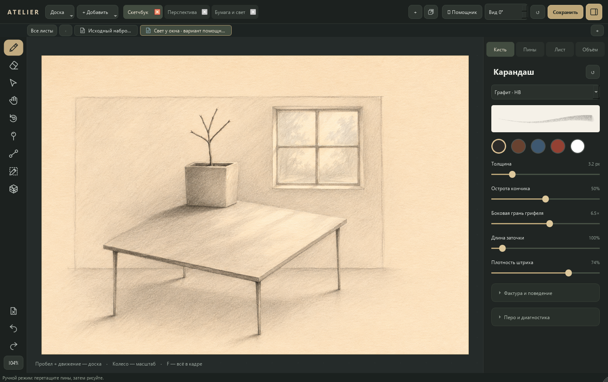
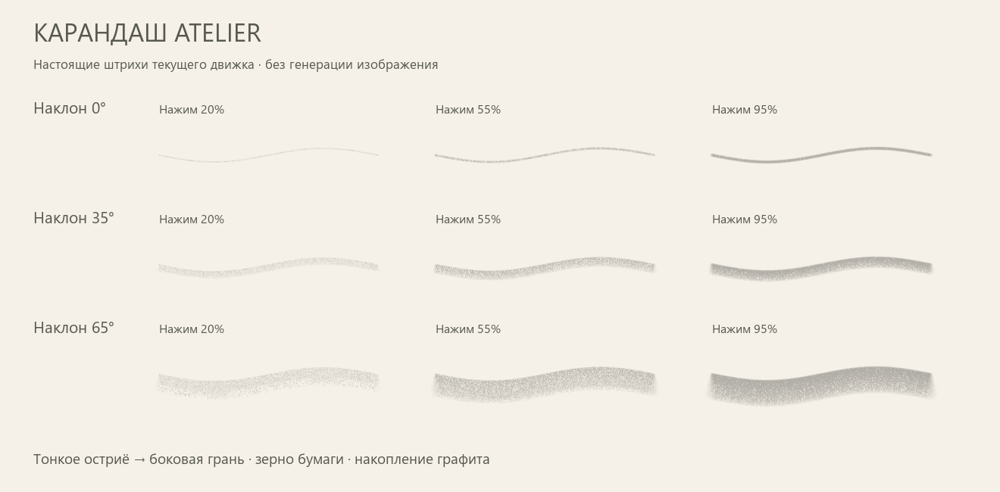
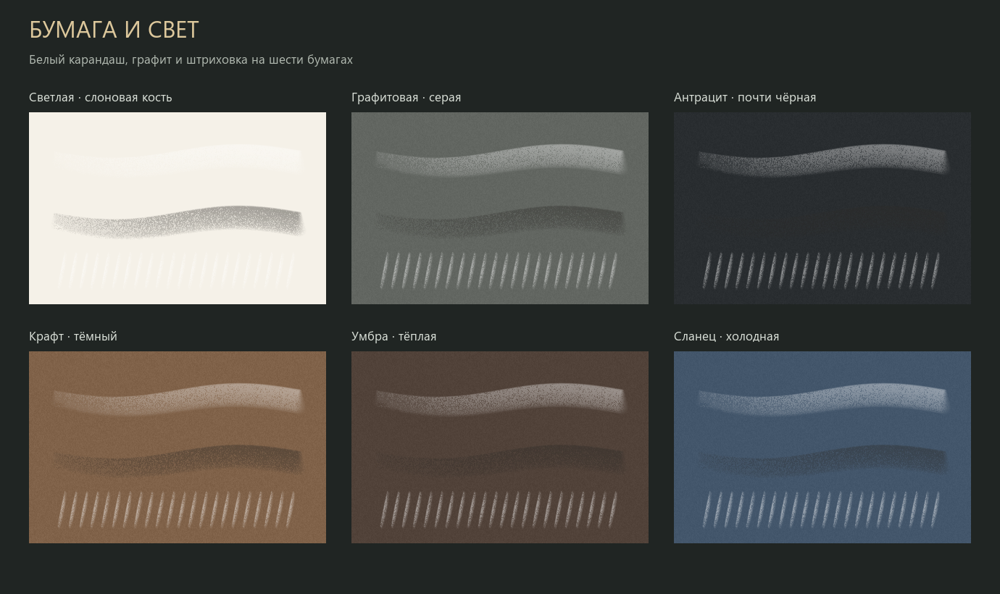
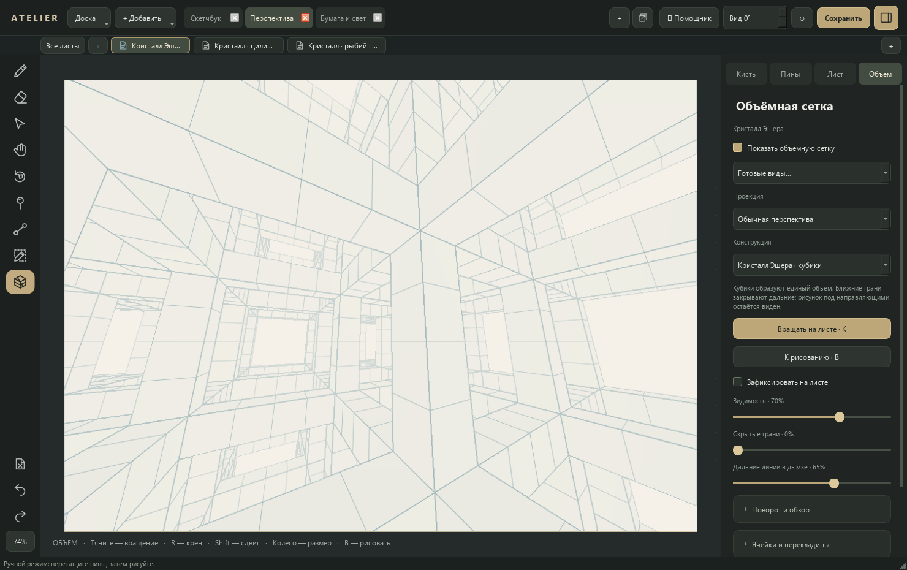
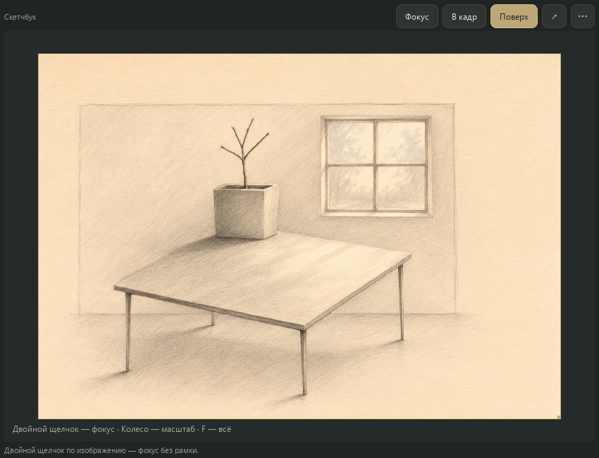
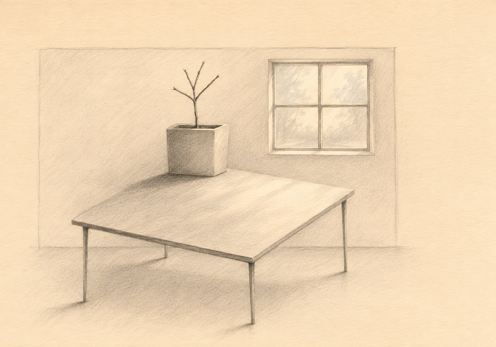
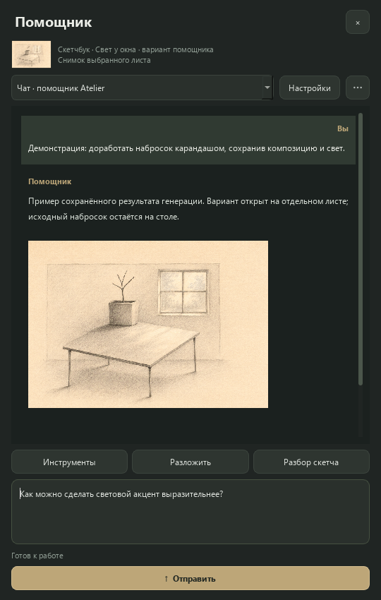

<div align="center">

# Atelier

**Карандаш, бумага и пространство для рисунка.**

A Windows sketchpad with a tilt-aware pencil, spatial perspective guides and floating references.

**0.17.1 · Windows · Wacom / WinTab · Python + Qt · Интерфейс на русском**

[Установка](#установка) · [Возможности](#возможности) · [Горячие клавиши](#горячие-клавиши) · [Помощник](docs/assistant.md) · [Разработка](docs/development.md)

</div>



Atelier — рабочий прототип скетчпада для художника, которому удобно думать на большом столе: раскладывать листы и референсы, строить перспективу, набрасывать карандашом и уточнять рисунок на кальке. Вместо одного неподвижного холста — несколько столов, листы с собственными настройками и отдельные окна для справочных изображений.

Рисование, проекты и направляющие работают **локально, без аккаунта и сети**. ИИ-помощник подключается отдельно. На главном скриншоте открыт демонстрационный рисунок, ранее полученный через помощника; образцы штрихов ниже созданы собственным движком Atelier.

## Возможности

| Инструмент | Что можно делать |
|---|---|
| **Карандаш с наклоном** | Рисовать тонким остриём и боковой гранью. Настраивать нажим, остроту, зерно, плотность, стабилизацию и длину заточки до 1000%. |
| **Бумага и клячка** | Выбирать светлую бумагу, графитовую, антрацит, крафт, умбру или сланец; рисовать белым. Мягко снимать пигмент круглой клячкой или клячкой в форме карандаша. |
| **Калька и Alt-слои** | Класть прозрачный лист над наброском. Удерживать Alt для построений на отдельном слое с собственным цветом, видимостью и прозрачностью. |
| **Столы, листы и папки** | Работать в нескольких вкладках, группировать листы в папки, перемещать их и копировать между столами. |
| **Пины и резинки** | Соединять любые пины направляющими, продлевать линии и привязывать к ним штрихи. Мышь может двигать пин независимо от рисующего пера. |
| **Объёмная перспектива** | Вращать кристалл Эшера и прозрачные решётки; менять размер и число ячеек, проекцию, деформации, дымку и видимость скрытых граней. |
| **Плавающие референсы** | Открывать стол поверх других приложений и уносить его на другой монитор. Двойной щелчок оставляет только выбранную картинку без рамки. |
| **Помощник и Inpaint** | Обсуждать скетч, поручать действия в Atelier, получать варианты на новых листах и перерисовывать выделенные области. |

### Карандаш и бумага

Контакт грифеля асимметричен: тонкая точка касания переходит в расширяющуюся боковую грань. Наклон меняет форму и направление пятна, а нажим — характер нанесения пигмента. Настройки каждого пресета сохраняются; кнопка сброса возвращает исходные значения.





### Пространственные направляющие

Кристалл состоит из повторяющихся кубических объёмов. Ближние грани скрывают дальние, а ползунок позволяет проявить скрытые линии. Есть обычная, параллельная, цилиндрическая, сферическая, равноудалённая, стереографическая и художественная перцептивная проекции. Сетку можно вращать, наклонять относительно горизонта, растягивать и деформировать.



Конструкция вдохновлена работой М. К. Эшера и рисовальными построениями David Chelsea. Это направляющая для рисунка, а перцептивный режим — художественная настройка, без претензии на физиологическую модель зрения. [Историческая справка и источники](docs/escher-history.md).

### Референс без окна

Откройте стол кнопкой с двумя окнами рядом с вкладками. **Дважды щёлкните по картинке** или нажмите «Фокус»: рамка, панели и фон исчезнут. Перетаскивание двигает картинку по экрану, колёсико меняет её размер. **Esc или повторный двойной щелчок** возвращает прежний вид. Исходный лист при этом не перемещается и не масштабируется.

| Окно референсов | Режим фокуса |
|---|---|
|  |  |

### Помощник в отдельном окне

Чат хранит вопросы, ответы и результаты. Помощник видит структуру столов и может создавать и раскладывать листы, организовывать папки, настраивать кисть, направляющие и сетки. Перед удалением и очисткой показывает предлагаемые действия. При изменении стола во время ожидания также предлагает проверить команды.

Для изображений доступны ChatGPT через локальный мост Codex, OpenAI API и Higgsfield. Есть десять художественных пресетов и свободное описание. **Без галочки «Улучшить мой промпт» введённый текст не переписывается и стиль из списка не применяется.** Для Inpaint отдельно передаются технические условия выделения.



Inpaint использует мягкий переход и согласование тона на границе маски. Режим повышенной детализации обрабатывает выделенный фрагмент с запасом окружающего фона и возвращает его на место. Пиксели вне области наложения сохраняются локально; исходник остаётся отдельным листом.

Подключения, ограничения и передаваемые данные описаны в [руководстве по помощнику](docs/assistant.md). Снимки интерфейса сделаны на демонстрационных данных; [происхождение иллюстраций](docs/screenshots/README.md).

## Установка

**Проверенная конфигурация:** Windows x64, Python 3.10, PySide6 6.8.3. Для пера нужен драйвер Wacom/WinTab; наклон работает только на поддерживающем его оборудовании. Для работы мышью планшет не требуется. Сборка распространяется как исходный код, без готового EXE и личных настроек.

1. Установите **64-битный Python 3.10**. Установщик также допускает Python 3.11–3.12, но основной набор проверок выполняется на 3.10.
2. Скачайте репозиторий через **Code → Download ZIP** и распакуйте его либо выполните:

   ```powershell
   git clone https://github.com/BenderBlender/Atelier.git
   cd Atelier
   ```

3. Запустите **`Install Atelier.cmd`**. Он создаст `.venv` и установит зависимости. На этом шаге нужен интернет.
4. Откройте **`Start Atelier.vbs`**. Запуск с отображением ошибок — **`Start Atelier.cmd`**.

Для ручной установки:

```powershell
py -3.10 -m venv .venv
.\.venv\Scripts\python.exe -m pip install -r requirements.txt
.\.venv\Scripts\python.exe main.py
```

Первое построение кисти или сетки может занять больше времени: Numba подготавливает ускоренные вычисления. При проблемах с ускорителем есть резервный режим: `$env:ATELIER_BRUSH_BACKEND='numpy'` перед запуском.

**Подключения ИИ необязательны.** Исполняемые компоненты Codex и Higgsfield не входят в Git-репозиторий. Для них есть отдельная [инструкция](runtime/README.md); рисование работает и без них.

## Первые пять минут

1. Нарисуйте несколько штрихов инструментом **B**, меняя нажим и наклон. Подстройте толщину, боковую грань и заточку справа.
2. Удерживайте **Alt**, чтобы добавить построения. Отпустите Alt и продолжите основной рисунок.
3. Добавьте прозрачный лист через **T**, чтобы уточнить набросок на кальке.
4. Перетащите PNG/JPEG/WebP на стол или нажмите **Ctrl+I**. **V** позволяет двигать листы, **F** показывает весь стол.
5. Сохраните проект через **Ctrl+S**. Формат `.atelier` хранит листы, рисунки, Alt-слои, папки, пины, резинки и настройки сеток. Экспорт PNG доступен в меню «Доска».

## Горячие клавиши

| Действие | Клавиша / жест |
|---|---|
| Карандаш / клячка / выбор | **B / E / V** |
| Уменьшить / увеличить кисть | **[ / ]**, также **Х / Ъ** в русской раскладке |
| Рисовать на слое направляющих | Удерживать **Alt** |
| Очистить только текущий Alt-слой | **Alt + кнопка очистки** |
| Добавить кальку | **T** |
| Перемещать вид | **H**, средняя кнопка или **пробел + перетаскивание** |
| Масштабировать / показать весь стол | **Колесо / F** |
| Временно вращать холст | Удерживать **R** и перетаскивать; **Shift** — шаг 15° |
| Поставить пин / соединить пины | **P / G** |
| Мышь управляет пином, перо рисует | **M** |
| Выделение Inpaint / вращение сетки | **I / K** |
| Крен камеры сетки | **R + перетаскивание** в режиме **K** |
| Добавить к выделению лист | **Ctrl/Shift + щелчок** |
| Копировать / вставить / дублировать листы | **Ctrl+C / Ctrl+V / Ctrl+D** |
| Отменить / повторить | **Ctrl+Z / Ctrl+Shift+Z**, также **Ctrl+Y** |
| Сохранить / открыть | **Ctrl+S / Ctrl+O** |
| Скрыть панели / открыть справку | **Tab / F1** |
| Фокус на плавающем референсе | **Двойной щелчок**; выход — **Esc** или двойной щелчок |

## Статус проекта

Atelier — развивающийся прототип. Собственный карандашный движок вдохновлён поведением реального грифеля; это не движок Procreate и не обещание идентичного ощущения. Есть основной растровый рисунок, отдельные слои направляющих и калька отдельными листами, но нет универсального стека художественных слоёв, CMYK и управления цветом уровня печатного редактора.

Мышь и Wacom проверяются отдельно: автоматические тесты не измеряют задержку реального пера. Работа двух рук использует Windows Raw Input и рассчитана на относительную физическую мышь. Совместимость Linux/macOS и всех планшетных драйверов не заявлена.

Публикация 0.17.1 подготовлена с **195 локально пройденными тестами**, дополнительной проверкой интерфейса и режима фокуса в Windows. Платные генерации не выполняются в тестах CI. Подробности — в [документации разработчика](docs/development.md).
